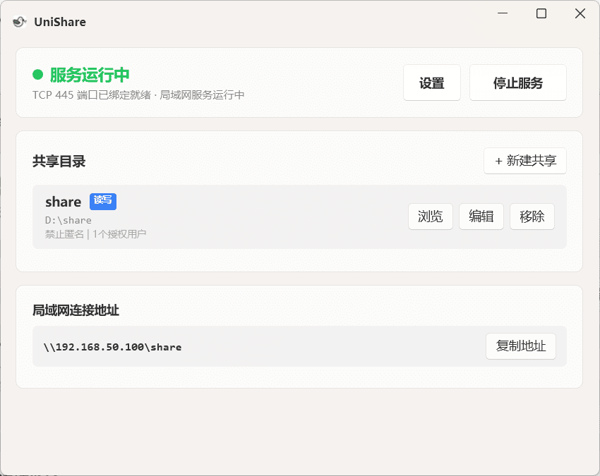

# UniShare

**简单、安全、稳定的 Windows 局域网文件共享（SMB）工具，告别繁琐配置与连接报错。**

[**📥 下载最新安装包**](https://github.com/xfgdck/UniShare.Windows/releases) | [**🐛 反馈问题**](https://github.com/xfgdck/UniShare.Windows/issues)

### 主要特性

- **虚拟账户**：独立设置共享账号与密码，无需暴露 Windows 系统账户与开机密码。
- **稳定兼容**：智能适配多种安全认证协议，兼顾新老设备，彻底解决莫名连不上的问题。
- **高速传输**：专为大文件与高清影音调优，局域网满速秒传，流畅直放 4K 原盘快进不卡顿。
- **自动发现**：内置跨平台广播服务，手机、电视与电脑免输 IP，打开列表即可直接找到本机。

### 应用截图

### 使用方法

1. 前往 [Releases](https://github.com/xfgdck/UniShare.Windows/releases) 下载最新安装包并安装。
2. 打开应用，点击「新建共享」，选择需要共享的本地文件夹，配置访问用户名、密码及权限。
3. 点击右上角「启动服务」。
4. 在其他设备（Android 手机、平板、安卓电视或电脑）上直接通过局域网自发现连接，或输入电脑 IP 地址访问：
   - **Android 手机 / 平板**：在文件管理器或播放器中直接扫描或添加局域网服务器
   - **安卓电视 / 电视盒子**：在 Kodi、VLC 等电视端播放器中自动扫描或连接
   - **Windows 电脑**：在文件资源管理器地址栏输入 `\\<IP>\<共享名>`

### 开发者与 AI 协作规范

- **工程架构、协议规范与协作规范**：详细系统架构、协议合规标准、开发准则与 AI 协作自检清单请阅读 [AGENT.md](AGENT.md)

### 开源许可

本项目主程序基于 [GNU General Public License v3.0 (GPLv3)](LICENSE) 开源，内置底层 SMB 协议栈遵循 [GNU Lesser General Public License v3.0 (LGPLv3)](SMBLibrary/License.txt)。

